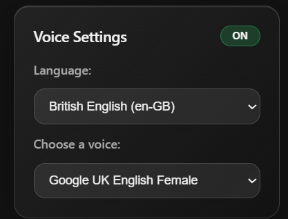

# Minimal Text-to-Speech

A lightweight Chrome extension (Manifest V3) that reads selected text aloud. Select text on any web page and a small floating control bar appears with play, pause, stop and speed controls. For Chrome's built-in PDF viewer, where page scripts can't run, the same features are available from the right-click menu.

No accounts, no servers, no tracking: everything runs locally using the browser's built-in speech engine.


## Features

- **Floating controls on any page.** Select text and a glass-style bar appears next to it with Read, Pause/Resume, Stop and Speed buttons. It stays readable on both light and dark pages.
- **Speed control.** Cycle through 1x, 1.25x, 1.5x and 2x. Changing speed mid-reading continues from roughly where you were.
- **Voice and language selection.** Choose from every voice installed on your system or provided by Chrome, filtered by language.
- **Language mismatch guard.** If the selected text is in a different language from your chosen voice, the extension warns you instead of reading it badly.
- **Chrome PDF viewer support.** Right-click a selection and use *Read selection aloud*, *Pause / Resume*, *Stop reading* and a *Speed* submenu.
- **Multi-tab aware.** The speech engine is shared across tabs. If another tab takes over while you are paused, Resume restarts from the last spoken word.
- **On/off switch.** Disable the floating bar from the popup without uninstalling.
- **Remembers your settings** (voice, language, speed, on/off) via `chrome.storage.sync`.

## Installation

The extension is not on the Chrome Web Store yet, so load it as an unpacked extension:

1. Clone or download this repository.
   ```bash
   git clone https://github.com/adi-samson7/text-to-voice-extension.git
   ```
2. Open `chrome://extensions` in Chrome.
3. Turn on **Developer mode** (top right).
4. Click **Load unpacked** and select the project folder.
5. Pin the extension from the puzzle-piece menu if you want quick access to its settings.

> After pulling updates, click the reload icon on the extension's card and refresh any open tabs. Tabs opened before a reload keep an outdated copy of the content script.

## Usage

### On regular web pages
1. Select some text.
2. Click **🔊 Read** in the floating bar.
3. Use **⏸ / ▶** to pause and resume, **⏹** to stop, and the speed button (**1x**) to cycle speeds.

Clicking anywhere else on the page dismisses the bar and stops reading.

### In Chrome's PDF viewer
Chrome does not allow extensions to inject content into its PDF viewer, so use the context menu instead:

1. Select text in the PDF.
2. Right-click, open **Minimal Text-to-Speech**, and choose **Read selection aloud**.
3. Use **Pause / Resume**, **Stop reading** and **Speed** from the same menu.

For PDFs opened from your computer (`file://`), enable **Allow access to file URLs** on the extension's details page in `chrome://extensions` if the menu item does not appear.

### Voice settings
Click the extension icon to open the settings popup.



- **ON/OFF**: enable or disable the floating bar.
- **Language** and **Choose a voice**: pick the voice used for reading. It applies to both the floating bar and the right-click menu.

## How it works

| File | Role |
| --- | --- |
| `manifest.json` | Manifest V3 configuration, permissions (`activeTab`, `storage`, `contextMenus`, `tts`), content script and service worker registration. |
| `content.js` | Runs on every page. Detects selections, shows the floating controls, and speaks via the Web Speech API (`speechSynthesis`). |
| `styles.css` | Styles for the floating control bar. |
| `background.js` | Service worker. Builds the right-click menu and speaks via the `chrome.tts` API, which works in the PDF viewer. |
| `popup.html` / `popup.js` / `popup.css` | The settings popup (on/off, language, voice). |

Settings are stored in `chrome.storage.sync`: `isEnabled`, `selectedLang`, `selectedVoice` and `speechRate`.

## Permissions

| Permission | Why it is needed |
| --- | --- |
| `storage` | Save your voice, language, speed and on/off choice. |
| `activeTab` | Work with the page you are currently on. |
| `contextMenus` | Add the right-click menu used in the PDF viewer. |
| `tts` | Read text aloud from the background script. |
| Content script on all URLs | Detect text selections so the floating bar can appear on any site. |

Selected text is only passed to your browser's speech engine. Depending on the voice you pick, the browser may send text to a network speech service (for example, Google voices in Chrome); voices labelled "Microsoft …" or other locally installed voices process everything on your device.

## Known limitations

- **No floating bar in Chrome's PDF viewer.** This is a Chrome restriction, so the right-click menu is used there.
- **Network voices stop on long text.** Chrome's Google voices can cut off after roughly 15 seconds of continuous speech. Locally installed voices do not have this problem.
- **Speed changes restart the sentence position.** Rate cannot change mid-utterance, so the speech restarts from the last known word. Voices that do not report word positions use an estimate, so the restart point can be slightly off.
- **Selections in form fields** (inputs and textareas) may not trigger the floating bar on every site.
- **Chrome only.** Other Chromium browsers may work but are untested.

## Contributing

Issues and pull requests are welcome. There is no build step: edit the files, reload the extension at `chrome://extensions`, and refresh your test tabs.

## License

No license has been specified yet. Add a `LICENSE` file to define how others may use this code.
